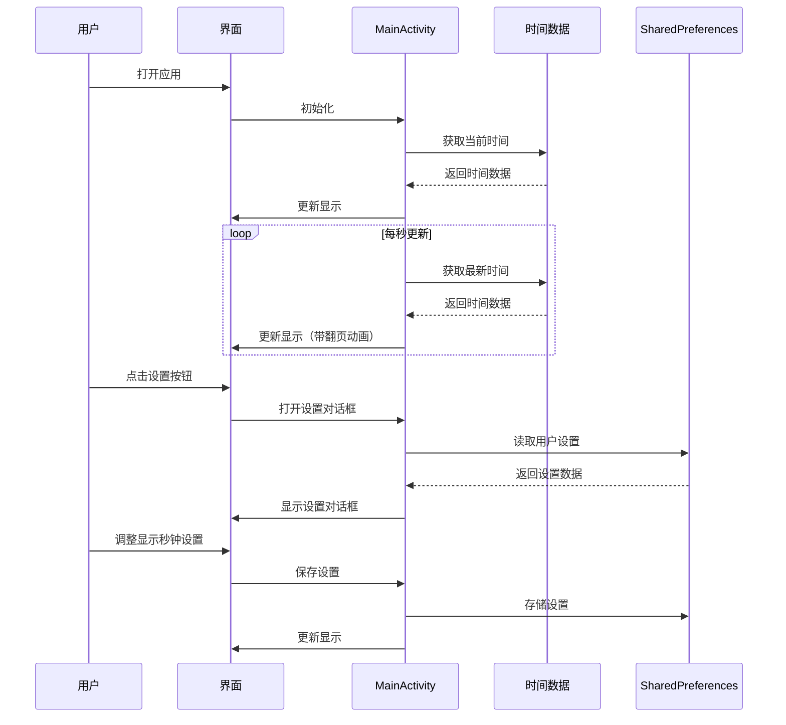

# 翻页时钟应用设计文档

## 1. 架构设计

### 1.1 架构模式

采用 **MVC (Model-View-Controller)** 架构模式：

- **Model**：时间数据和用户设置
- **View**：用户界面，包括MainActivity和FlipDigit
- **Controller**：MainActivity，处理用户交互和业务逻辑

### 1.2 模块划分

| 模块 | 职责 | 文件 |
|------|------|------|
| 主界面 | 显示时钟和设置按钮 | MainActivity.kt, activity_main.xml |
| 翻页数字 | 实现翻页动画效果 | FlipDigit.kt |
| 设置功能 | 管理用户设置 | dialog_settings.xml |
| 资源管理 | 管理字符串、样式等资源 | strings.xml, themes.xml |

### 1.3 数据流设计



## 2. 界面设计

### 2.1 主界面

| 元素 | 描述 | 位置 | 尺寸 |
|------|------|------|------|
| AM/PM标识 | 显示上午/下午 | 左上角 | 24sp |
| 小时数字 | 翻页显示小时 | 左侧 | 60dp × 100dp |
| 分钟数字 | 翻页显示分钟 | 中间 | 60dp × 100dp |
| 秒钟数字 | 翻页显示秒钟（可选） | 右侧 | 60dp × 100dp |
| 冒号 | 分隔时、分、秒 | 数字之间 | 48sp |
| 设置按钮 | 打开设置对话框 | 左上角 | 48dp × 48dp |

### 2.2 设置对话框

| 元素 | 描述 | 位置 | 尺寸 |
|------|------|------|------|
| 标题 | "设置" | 顶部 | 16sp |
| 显示秒钟开关 | 控制是否显示秒钟 | 中部 | 标准Switch控件 |
| 确定按钮 | 关闭对话框 | 底部 | 标准按钮 |

### 2.3 色彩方案

| 元素 | 颜色 | 说明 |
|------|------|------|
| 背景 | #000000 (黑色) | 深色主题，适合夜间使用 |
| 数字 | #FFFFFF (白色) | 高对比度，清晰可见 |
| 卡片背景 | #323232 (深灰色) | 数字卡片背景 |
| 分隔线 | #1E1E1E (暗灰色) | 卡片中间的分隔线 |
| 按钮 | #FFFFFF (白色) | 设置按钮图标 |

### 2.4 字体方案

| 元素 | 字体 | 大小 |
|------|------|------|
| 数字 | 系统默认字体 | 60sp |
| AM/PM | 系统默认字体 | 24sp |
| 冒号 | 系统默认字体 | 48sp |
| 设置标题 | 系统默认字体 | 16sp |

## 3. 关键类设计

### 3.1 MainActivity

| 方法 | 职责 | 参数 | 返回值 |
|------|------|------|--------|
| `onCreate()` | 初始化活动 | Bundle? | 无 |
| `updateTime()` | 更新时间显示 | 无 | 无 |
| `showSettingsDialog()` | 显示设置对话框 | 无 | 无 |
| `onOptionsItemSelected()` | 处理菜单选择 | MenuItem | Boolean |
| `onDestroy()` | 清理资源 | 无 | 无 |

### 3.2 FlipDigit

| 方法 | 职责 | 参数 | 返回值 |
|------|------|------|--------|
| `setDigit()` | 设置数字并触发动画 | Int (数字) | 无 |
| `startAnimation()` | 开始翻页动画 | 无 | 无 |
| `setAnimationProgress()` | 设置动画进度 | Float (进度) | 无 |
| `onDraw()` | 绘制数字和动画 | Canvas | 无 |

## 4. 动画设计

### 4.1 翻页动画

- **动画类型**：3D翻转动画
- **持续时间**：500毫秒
- **插值器**：AccelerateDecelerateInterpolator
- **动画流程**：
  1. 上半部分数字开始翻转
  2. 翻转到90度时，切换到新数字
  3. 继续翻转到180度，完成动画

### 4.2 性能优化

- 使用硬件加速
- 减少不必要的重绘
- 优化动画计算逻辑
- 仅在数字变化时触发动画

## 5. 存储设计

### 5.1 用户设置存储

| 设置项 | 类型 | 默认值 | 存储位置 |
|--------|------|--------|----------|
| showSeconds | Boolean | true | SharedPreferences |

### 5.2 存储实现

```kotlin
// 读取设置
val sharedPreferences = getSharedPreferences("flip_clock_settings", Context.MODE_PRIVATE)
val showSeconds = sharedPreferences.getBoolean("show_seconds", true)

// 保存设置
val editor = sharedPreferences.edit()
editor.putBoolean("show_seconds", showSeconds)
editor.apply()
```

## 6. 性能设计

### 6.1 时间更新优化

- 根据是否显示秒钟调整更新频率：
  - 显示秒钟：1秒更新一次
  - 不显示秒钟：1分钟更新一次

### 6.2 动画性能优化

- 使用ObjectAnimator，利用硬件加速
- 避免在动画过程中进行复杂计算
- 合理设置动画持续时间，平衡视觉效果和性能

### 6.3 内存优化

- 正确管理Handler，避免内存泄漏
- 及时释放动画资源
- 优化自定义View的绘制逻辑

## 7. 兼容性设计

### 7.1 屏幕适配

- 使用ConstraintLayout实现响应式布局
- 使用dp作为尺寸单位，确保在不同屏幕密度下的一致性
- 针对不同屏幕尺寸进行测试

### 7.2 系统版本适配

- 最低支持Android 7.0 (API 24)
- 使用兼容库确保在不同版本的Android上正常运行
- 针对不同Android版本的特性进行适配

## 8. 测试设计

### 8.1 功能测试

| 测试项 | 测试内容 | 预期结果 |
|--------|----------|----------|
| 时间显示 | 验证时间是否正确显示 | 显示当前时间 |
| 翻页动画 | 验证时间变化时是否有翻页动画 | 数字变化时出现翻页效果 |
| AM/PM显示 | 验证AM/PM是否正确显示 | 上午显示AM，下午显示PM |
| 秒钟控制 | 验证是否可以控制秒钟显示 | 开关可以控制秒钟显示/隐藏 |
| 设置保存 | 验证设置是否能持久保存 | 重启应用后保持设置 |

### 8.2 性能测试

| 测试项 | 测试内容 | 预期结果 |
|--------|----------|----------|
| 动画流畅度 | 测试翻页动画是否流畅 | 动画流畅，无卡顿 |
| 响应速度 | 测试设置操作的响应速度 | 操作响应迅速 |
| 电池消耗 | 测试应用的电池消耗 | 电池消耗正常 |

### 8.3 兼容性测试

| 测试项 | 测试内容 | 预期结果 |
|--------|----------|----------|
| 屏幕适配 | 在不同尺寸的设备上测试 | 正常显示 |
| 系统版本 | 在不同Android版本上测试 | 正常运行 |

## 9. 部署设计

### 9.1 构建配置

- **构建工具**：Gradle
- **构建类型**：Debug和Release
- **签名配置**：使用密钥库签名

### 9.2 发布渠道

- **Google Play Store**：正式发布渠道
- **APK文件**：测试和手动安装

### 9.3 版本管理

- **版本号**：使用语义化版本号
- **更新策略**：定期更新，修复bug和添加新功能

## 10. 代码规范

### 10.1 命名规范

- **类名**：PascalCase（如MainActivity）
- **方法名**：camelCase（如updateTime）
- **变量名**：camelCase（如hourTens）
- **资源名**：snake_case（如show_seconds_switch）

### 10.2 代码风格

- 使用Kotlin的现代语法
- 保持代码简洁明了
- 适当添加注释
- 遵循Android官方代码风格指南

### 10.3 文档规范

- 为关键类和方法添加注释
- 编写详细的README.md
- 维护更新日志
