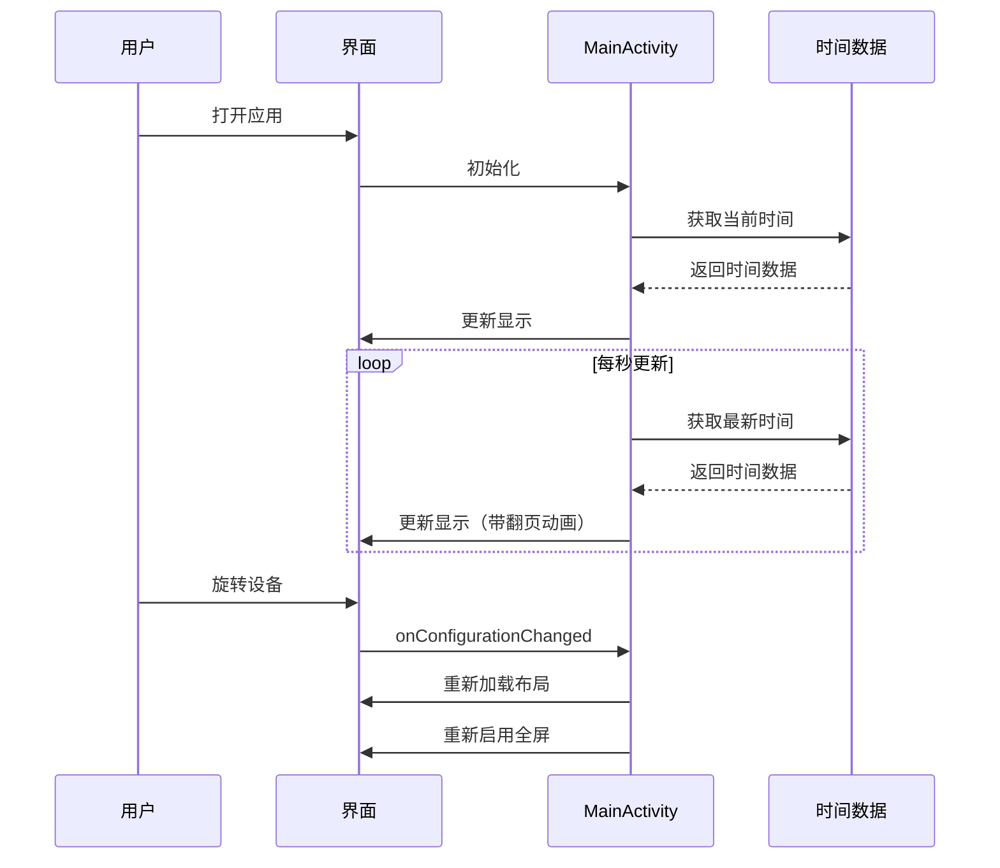

# 翻页时钟应用设计文档

## 1. 架构设计

### 1.1 架构模式

采用 **MVC (Model-View-Controller)** 架构模式：

- **Model**：时间数据
- **View**：用户界面，包括MainActivity、FlipDigit和BlinkingColon
- **Controller**：MainActivity，处理时间更新和屏幕配置变化

### 1.2 模块划分

| 模块 | 职责 | 文件 |
|------|------|------|
| 主界面 | 显示时钟，处理横竖屏切换 | MainActivity.kt, activity_main.xml |
| 翻页数字 | 实现3D翻页动画效果 | FlipDigit.kt |
| 闪烁冒号 | 实现冒号闪烁动画 | BlinkingColon.kt |
| 资源管理 | 管理字符串、样式等资源 | strings.xml, themes.xml, bg_gradient.xml |

### 1.3 数据流设计



## 2. 界面设计

### 2.1 主界面（竖屏）

| 元素 | 描述 | 位置 | 尺寸 |
|------|------|------|------|
| 小时数字 | 翻页显示小时 | 上方 | 130dp × 200dp |
| 冒号 | 闪烁分隔符 | 中间 | 60dp × 80dp |
| 分钟数字 | 翻页显示分钟 | 下方 | 130dp × 200dp |

### 2.2 主界面（横屏）

| 元素 | 描述 | 位置 | 尺寸 |
|------|------|------|------|
| 小时数字 | 翻页显示小时 | 左侧 | 自适应 |
| 冒号 | 闪烁分隔符 | 中间 | 自适应 |
| 分钟数字 | 翻页显示分钟 | 右侧 | 自适应 |

### 2.3 色彩方案

| 元素 | 颜色 | 说明 |
|------|------|------|
| 背景 | 渐变背景 | 从深灰到黑色的渐变 |
| 数字 | #FAFAFA (近白色) | 高对比度，清晰可见 |
| 上半卡片顶部 | #484848 | 模拟光照较亮区域 |
| 上半卡片底部 | #383838 | 与下半卡片顶部衔接 |
| 下半卡片顶部 | #383838 | 与上半卡片底部衔接 |
| 下半卡片底部 | #2C2C2C | 模拟阴影较暗区域 |
| 中缝 | #282828 | 凹陷阴影效果 |

### 2.4 字体方案

| 元素 | 字体 | 大小 |
|------|------|------|
| 数字 | 系统默认字体 | 视图高度的55% |
| 冒号 | 系统默认字体 | 视图高度的50% |

## 3. 关键类设计

### 3.1 MainActivity

| 方法 | 职责 | 参数 | 返回值 |
|------|------|------|--------|
| `onCreate()` | 初始化活动，设置全屏模式 | Bundle? | 无 |
| `enableFullScreen()` | 启用沉浸式全屏模式 | 无 | 无 |
| `onWindowFocusChanged()` | 窗口获得焦点时重新启用全屏 | Boolean | 无 |
| `onConfigurationChanged()` | 处理横竖屏切换 | Configuration | 无 |
| `updateTime()` | 更新时间显示 | 无 | 无 |
| `onDestroy()` | 清理Handler资源 | 无 | 无 |

### 3.2 FlipDigit

| 方法 | 职责 | 参数 | 返回值 |
|------|------|------|--------|
| `setDigit()` | 设置数字并触发动画 | Int (0-9) | 无 |
| `startFlipAnimation()` | 开始3D翻页动画 | 无 | 无 |
| `onDraw()` | 绘制数字和动画 | Canvas | 无 |
| `drawStaticState()` | 绘制静态状态 | Canvas, ... | 无 |
| `drawFlippingState()` | 绘制翻页状态 | Canvas, ... | 无 |
| `drawTopCard()` | 绘制上半卡片 | Canvas, ... | 无 |
| `drawBottomCard()` | 绘制下半卡片 | Canvas, ... | 无 |
| `drawGapEffect()` | 绘制中缝效果 | Canvas, ... | 无 |
| `drawEdgeHighlight()` | 绘制边缘高光 | Canvas, ... | 无 |

### 3.3 BlinkingColon

| 方法 | 职责 | 参数 | 返回值 |
|------|------|------|--------|
| `alphaValue` | 属性setter，控制透明度 | Float | 无 |
| `onDraw()` | 绘制冒号 | Canvas | 无 |

## 4. 动画设计

### 4.1 翻页动画

- **动画类型**：3D翻转动画（使用Camera类）
- **持续时间**：800毫秒
- **插值器**：OvershootInterpolator(0.8f) - 带轻微回弹
- **动画流程**：
  1. 阶段1 (0-0.5)：上半卡片向下翻转0-90度，显示当前数字
  2. 阶段2 (0.5-1)：下半卡片从上方翻入90-0度，显示新数字

### 4.2 冒号闪烁动画

- **动画类型**：透明度渐变
- **持续时间**：1000毫秒
- **范围**：1.0 → 0.3 → 1.0（循环）
- **插值器**：AccelerateDecelerateInterpolator

### 4.3 性能优化

- 使用硬件加速（LAYER_TYPE_HARDWARE）
- 减少不必要的重绘
- 优化动画计算逻辑
- 仅在数字变化时触发动画

## 5. 横竖屏适配

### 5.1 配置变更处理

- 在AndroidManifest.xml中声明 `configChanges`
- 在 `onConfigurationChanged` 中重新加载布局
- 重新初始化视图引用
- 重新启用全屏模式

### 5.2 布局策略

- 竖屏：时分上下排列，使用LinearLayout垂直布局
- 横屏：时分左右排列，使用LinearLayout水平布局
- 使用ConstraintLayout作为根容器实现居中

## 6. 全屏沉浸式模式

### 6.1 Android R+ (API 30+)

```kotlin
window.setDecorFitsSystemWindows(false)
window.insetsController?.let { controller ->
    controller.hide(WindowInsets.Type.statusBars() or WindowInsets.Type.navigationBars())
    controller.systemBarsBehavior = WindowInsetsController.BEHAVIOR_SHOW_TRANSIENT_BARS_BY_SWIPE
}
```

### 6.2 Android R以下

```kotlin
window.decorView.systemUiVisibility = (
    View.SYSTEM_UI_FLAG_FULLSCREEN
    or View.SYSTEM_UI_FLAG_HIDE_NAVIGATION
    or View.SYSTEM_UI_FLAG_IMMERSIVE_STICKY
    or View.SYSTEM_UI_FLAG_LAYOUT_STABLE
    or View.SYSTEM_UI_FLAG_LAYOUT_FULLSCREEN
    or View.SYSTEM_UI_FLAG_LAYOUT_HIDE_NAVIGATION
)
```

## 7. 性能设计

### 7.1 时间更新优化

- 每秒更新一次时间
- 仅在数字变化时触发翻页动画

### 7.2 动画性能优化

- 使用ValueAnimator和硬件加速
- 避免在动画过程中进行复杂计算
- 合理设置动画持续时间，平衡视觉效果和性能

### 7.3 内存优化

- 正确管理Handler，在onDestroy中移除回调
- 及时释放动画资源
- 优化自定义View的绘制逻辑

## 8. 兼容性设计

### 8.1 屏幕适配

- 使用ConstraintLayout实现响应式布局
- 使用dp作为尺寸单位
- 提供横竖屏两套布局

### 8.2 系统版本适配

- 最低支持Android 7.0 (API 24)
- 目标SDK为API 36
- 针对不同Android版本的全屏API进行适配

## 9. 测试设计

### 9.1 功能测试

| 测试项 | 测试内容 | 预期结果 |
|--------|----------|----------|
| 时间显示 | 验证时间是否正确显示 | 显示当前小时和分钟 |
| 翻页动画 | 验证时间变化时是否有翻页动画 | 数字变化时出现3D翻页效果 |
| 冒号闪烁 | 验证冒号是否正常闪烁 | 冒号以1秒周期闪烁 |
| 横竖屏切换 | 验证旋转设备后布局是否正确 | 自动切换横竖屏布局 |
| 全屏模式 | 验证是否隐藏状态栏和导航栏 | 沉浸式全屏显示 |

### 9.2 性能测试

| 测试项 | 测试内容 | 预期结果 |
|--------|----------|----------|
| 动画流畅度 | 测试翻页动画是否流畅 | 动画流畅，无卡顿 |
| 电池消耗 | 测试应用的电池消耗 | 电池消耗正常 |

### 9.3 兼容性测试

| 测试项 | 测试内容 | 预期结果 |
|--------|----------|----------|
| 屏幕适配 | 在不同尺寸的设备上测试 | 正常显示 |
| 系统版本 | 在不同Android版本上测试 | 正常运行 |

## 10. 代码规范

### 10.1 命名规范

- **类名**：PascalCase（如MainActivity, FlipDigit）
- **方法名**：camelCase（如updateTime）
- **变量名**：camelCase（如hourTens）
- **资源名**：snake_case（如hour_tens）

### 10.2 代码风格

- 使用Kotlin的现代语法
- 保持代码简洁明了
- 适当添加注释
- 遵循Android官方代码风格指南

### 10.3 文档规范

- 为关键类和方法添加注释
- 编写详细的README.md
- 维护更新日志
